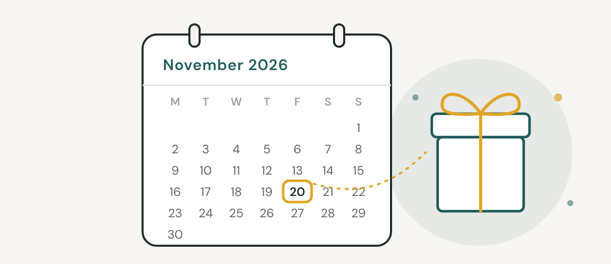
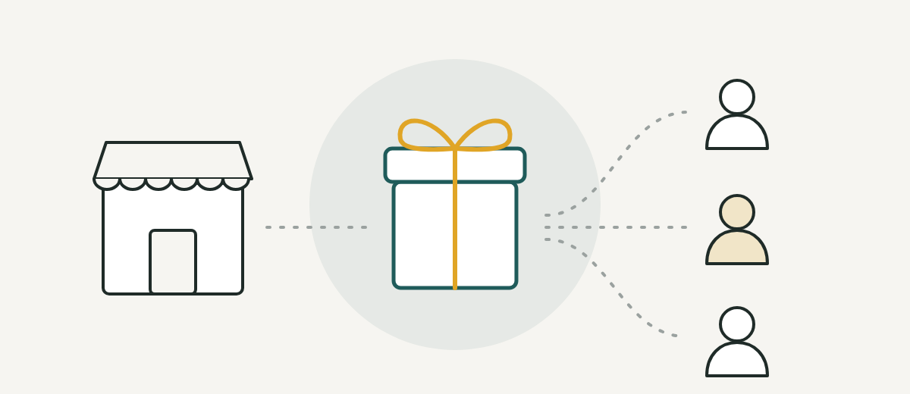
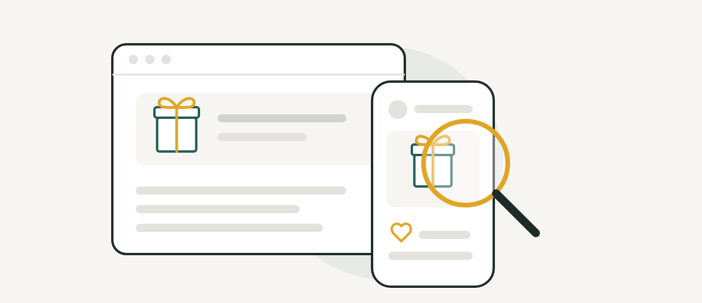

> **Quick answer:** From 20 November 2026, mostly no. The NDIS inducements ban makes it an offence for any provider, registered or unregistered, to give or offer anything that's reasonably likely to get someone to start, keep or increase using their services, whether it goes to the participant, their family or someone who refers to you. Genuine discounts and your own branded merchandise, like a cap or tote bag, are still allowed, but the Government says cash, gift cards, alcohol, tobacco and electronic devices are banned in all cases.

## What changes on 20 November 2026

A new section of the NDIS Act, section 73VA, bans NDIS inducements from 20 November 2026. It was added by the National Disability Insurance Scheme Amendment (Securing the NDIS for Future Generations) Act 2026, which became law on 20 August 2026. It's one of the 2026 NDIS legislation changes made by that Act.

You might see 27 November elsewhere, including on a government timeline. The Act itself starts the ban the day after 3 months from Royal Assent, which is 20 November, so plan for that date.

The ban applies to every NDIS provider, registered or unregistered. Under the Act, an NDIS provider includes anyone paid from a participant's NDIS funding, other than the participant. That covers sole traders, small teams, large organisations and plan managers.

Breaking the rule is a criminal offence, with up to 2 years in prison, a fine of up to 120 penalty units (currently $43,680), or both. Civil penalties are also available: up to 250 penalty units ($91,000), or 10,000 penalty units ($3.64 million) for a serious contravention by a provider.

The regulators were already acting on inducements. In a joint statement, the National Disability Insurance Agency (NDIA) and the NDIS Quality and Safeguards Commission (NDIS Commission) said they were investigating concerns that "some providers have offered cash, alcohol, cigarettes and other inducements to pressure participants into signing up" in the Northern Territory.

## What counts as an NDIS inducement?

Section 73VA has a three-part test. You breach it if you:

1. give, offer or agree to give a gift, benefit or other thing to a person, or cause one to be given
2. give something other than the support or service itself
3. give something reasonably likely to get that person to engage you to start or keep supporting a participant, add a support, increase the amount or intensity of a support, or manage a participant's plan funding

Gifts to participants are the obvious case, but two details catch people out. First, the Act says "it does not matter whether the person is the participant". A gift to a parent, a nominee or anyone else counts the same way. Second, you're responsible for gifts you get someone else to give for you, such as a staff member, a related business or an agency running a giveaway on your page.

An offer is enough. A web page promising a gift card to new participants breaches the rule even if nobody ever claims it.

The Act doesn't set a dollar limit or say small gifts are always fine. The question is whether the gift is reasonably likely to influence the decision.

## What's banned in all cases

The Government's fact sheet on the final law says providing "alcohol, tobacco and associated products, cash and cash-like products and electronic devices" is banned in all cases. The Act backs this up. Future NDIS rules can never permit any of these:

- alcohol
- cigarettes, cigars, tobacco products, e-cigarettes (vapes) and their accessories
- drugs that are illegal to possess
- cash
- cash-like products, which the Act says include gift cards, store cards, vouchers, money orders and digital currency, physical or electronic
- electronic devices, such as phones, tablets and gaming consoles

So a "$50 gift card for new participants", a tablet in a welcome pack or a bottle of wine in a Christmas hamper is off the table.

## What's still allowed

The Act has three exceptions:

- a discount, fee reduction or other benefit that's part of a legitimate pricing practice
- your own merchandise (the Government's examples are hats and tote bags)
- anything future NDIS rules specifically permit

Delivering the support itself isn't an inducement either.

The Act lets NDIS rules set out what counts as a legitimate pricing practice, what counts as your merchandise, and what other conduct is permitted. When we checked on 3 November 2026, we couldn't find any of those rules published.

Until they are, we'd suggest a cautious approach:

- Put any discount in your written price list or service agreement, apply it the same way to everyone in the same situation, and don't tie it to signing up, adding hours or referring someone.
- Keep merchandise simple and clearly yours, like a branded cap or tote bag.
- If you're unsure about something, don't give it until you've had advice.

## Is paying for referrals now illegal?

From 20 November, treat it as off limits. The Government's fact sheet says "a kickback is a payment, gift or other benefit given in exchange for favourable treatment or a business referral", and kickbacks are what the new offence targets. Because the gift doesn't have to go to the participant, payments to the people around them are in scope too.

The NDIA has already said its investigations show "a strong link between providers making 'incentive' or 'referral' payments and fraud".

What that means in practice:

- End any "pay per referral" arrangement, whether it's with a support coordinator, another provider, a community member or a participant's family.
- Stop thank-you gifts, hampers or vouchers for people who refer participants to you.
- If you have a paid partnership with a business that sends you participants, get legal advice on it before 20 November.

Whether a particular arrangement breaches section 73VA depends on its facts. If you're paying anyone who influences which provider a participant chooses, have a lawyer look at it.

## Where inducements hide in your marketing

Most providers would never hand a participant a wad of cash. The risk is the marketing set up months ago and forgotten: a pinned Facebook post, a website banner, a box of welcome packs in the office.

| Where to look | Risky example | Safer option |
|---|---|---|
| Website | "Sign up this month and get a $50 gift card" | Remove the offer |
| Facebook and Instagram | "Win an iPad: like, share and tag a friend" | Delete or archive old giveaways, including pinned posts |
| Referral program | "Refer a friend, get a $50 voucher" | End the program and tell the people in it |
| Welcome pack | A tablet or vouchers for new participants | Clear information and a branded cap or tote bag |
| Christmas | Hampers with wine, or vouchers for participants or support coordinators | A card, or your own merchandise |
| Google Business Profile | An "offer" post promising a gift | Remove the offer |
| Flyers and emails | Printed offers or email templates promising a reward | Reprint or rewrite them |

If an agency or contractor runs your marketing, brief them before 20 November. A giveaway they run on your page is still your giveaway.

Your social media doesn't need prizes to work. Families and support coordinators want to see what you do, who you support and where you work, posted regularly. That's the approach we take in our [social media work for NDIS providers](/social.html), where success is measured in enquiries, messages and referrals rather than likes.

## What to do before 20 November

1. Search your website, social media pages, Google Business Profile, flyers and email templates for words like "gift", "voucher", "win", "free" and "reward".
2. Remove or rewrite any offer that promises something for signing up, staying, adding hours or referring.
3. End referral payments and thank-you gifts, and get advice on any paid referral partnership.
4. Plan Christmas now: cards or your own merchandise, not hampers with alcohol, vouchers or devices.
5. Brief your staff and anyone who markets for you, including agencies and contractors.
6. Update your NDIS policies and procedures, starting with your gifts and benefits policy, so they cover what the business gives. Keep a simple record of what you give, to whom and why.
7. Watch for NDIS rules on pricing practices and merchandise, and for guidance from the NDIS Commission.

If your gifts policy hasn't been touched since you started, or you don't have one, this is a good week to sort it out. Our [policy writing service for NDIS providers](/policies.html) rewrites policies in plain English for the new NDIS changes. If you'd like a second opinion first, start with our [$166 Policy vs Practice Gap Check](/checks#gap-check).

## Common questions

### Does the NDIS inducements ban apply to unregistered providers?

Yes. Section 73VA applies to every NDIS provider, and the Act's definition covers anyone paid from a participant's NDIS funding, registered or not.

### Can I give participants a Christmas present?

There's no Christmas exception. A gift to an existing participant counts if it's reasonably likely to keep them with you, and the Government says alcohol, vouchers and electronic devices are banned in all cases. In our view, a card or your own branded merchandise is the sensible choice this year.

### Can I still offer a discount or a free first session?

Genuine discounts are allowed when they're part of a legitimate pricing practice, but the NDIS rules that define this hadn't been published when we checked. Keep any discount written into your pricing, the same for everyone in the same situation, and not tied to signing up or referrals. A free first session is less clear, so get advice before you offer one.

### Can I run a competition or giveaway on social media?

Be very careful. If the prize could sway a participant, family member or referrer towards choosing or staying with you, it's caught. Prizes like vouchers, cash or devices are banned in all cases. For most providers, it's simpler to stop running giveaways.

### Can my workers accept gifts from participants?

The ban doesn't cover that. Section 73VA only deals with gifts a provider gives, not gifts your workers receive. That's a matter for your own gifts and benefits policy, which in our view should say what workers can accept, what they must decline and how they record it.

> This is general information, not legal advice. Check your situation with the NDIS Commission or a lawyer who works with NDIS providers.

## Sources

- [Federal Register of Legislation: NDIS Amendment (Securing the NDIS for Future Generations) Act 2026 (section 73VA and the commencement table)](https://www.legislation.gov.au/C2026A00066/asmade/text)
- [Federal Register of Legislation: NDIS Act 2013, current compilation (definitions of NDIS provider and NDIS amount)](https://www.legislation.gov.au/C2013A00020/latest/text)
- [Department of Health, Disability and Ageing: Final changes to the NDIS Amendment (Securing the NDIS for Future Generations) Bill 2026](https://www.health.gov.au/sites/default/files/2026-08/final-changes-to-the-ndis-amendment-securing-the-ndis-for-future-generations-bill-2026.pdf)
- [Department of Health, Disability and Ageing: Final changes to the NDIS Bill, Easy Read](https://www.health.gov.au/sites/default/files/2026-09/final-changes-to-the-ndis-amendment-securing-the-ndis-for-future-generations-bill-2026-easy-read.pdf)
- [NDIS: Crackdown on NDIS fraud and exploitation in Northern Territory](https://www.ndis.gov.au/news/11103-crackdown-ndis-fraud-and-exploitation-northern-territory)
- [NDIS Commission: Parliament passed the NDIS Amendment (Securing the NDIS for Future Generations) Act 2026](https://www.ndiscommission.gov.au/media-centre/parliament-passed-ndis-amendment-securing-ndis-future-generations-act-2026)
- [Federal Register of Legislation: Crimes (Amount of a Penalty Unit) Instrument 2026](https://www.legislation.gov.au/F2026N00424/asmade/2026-06-16/text/original/pdf)
