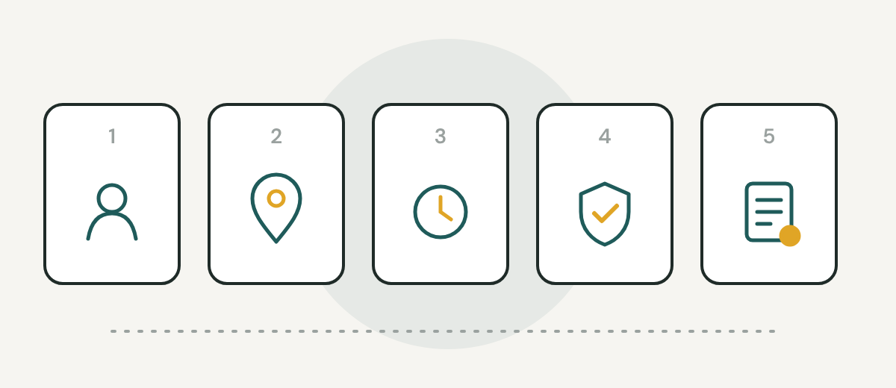
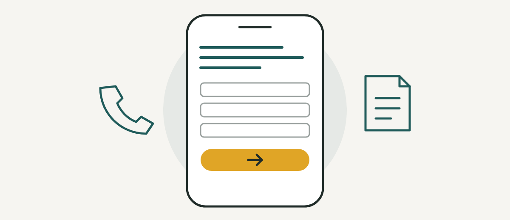
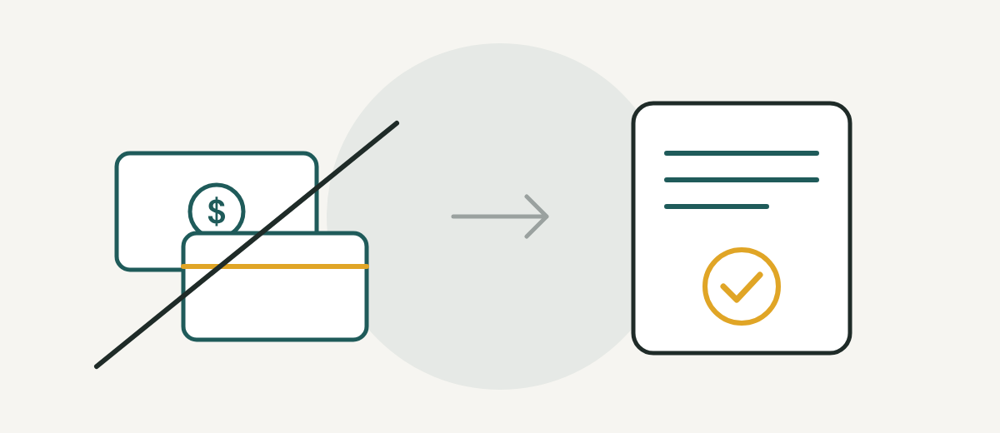

> **Quick answer:** In our experience, most NDIS referrals for a new provider come through support coordinators, and they refer to providers who are easy to check. Before they refer, coordinators look for five things: who you can serve, where you go, how soon you can start, how you keep people safe and how you'll report back. Put all five on one clear page of your website, then make sure coordinators can find it. No ads needed.

## Why support coordinators matter for NDIS referrals

[Part of a support coordinator's job](https://www.ndis.gov.au/participants/working-providers/support-coordinators-and-plan-managers/what-support-coordinator) is helping participants find providers who can meet their needs, compare and trial options, and agree on the supports and costs. So when a coordinator has a participant who needs what you offer, they're the one writing the shortlist.

They often do it fast, on a phone, between calls. The support coordinators we've spoken to look up a provider's website and Instagram before they refer. If the answers aren't there, it's easier to refer to the provider whose page has them.

A website on its own won't bring you clients. What it can do is stop you losing the ones who were already looking.

## The 5 things support coordinators check before they refer

### 1. Who you can serve

[NDIA-managed funding can only be used with registered providers](https://www.ndis.gov.au/participants/using-your-funding/ndia-managed/what-ndia-managed-funding). The NDIS puts it plainly: participants can't use unregistered providers for supports they have NDIA-managed funding for. [Self-managed and plan-managed participants can choose registered or unregistered providers](https://www.ndis.gov.au/participants/working-providers/get-know-your-providers/what-provider) for most supports, though some, like supported independent living (SIL), always need a registered provider.

So the first thing a coordinator needs to know is whether you're registered. If you're unregistered, write "We work with self-managed and plan-managed participants" near the top of every service page. If you're registered, say so, and say what you're registered to deliver. Coordinators can check the [NDIS Commission's provider register](https://www.ndiscommission.gov.au/provider-registration/find-registered-provider), and some will.

### 2. Where you go

List the suburbs you actually visit, and how far you'll travel. "Melbourne" or "all of Victoria" doesn't help a coordinator whose participant lives in one suburb on the edge of town. Cover only the north and west? Say that. A clear limit saves everyone a phone call.

For example: *"We visit Sunshine, St Albans, Deer Park and Footscray, up to 15 km from our office."* A coordinator can read that in 5 seconds.

### 3. How soon you can start

Some referrals are urgent, so coordinators ask about waitlists. Say whether you're taking new participants right now and how soon you can usually do a first visit. For example: *"Taking 3 new participants this month. First visit usually within 5 working days."* Then keep it current. A page that still says "taking new participants" three months after you filled your last spot costs you trust.

### 4. How you keep people safe

A coordinator is trusting you with someone's care. Show the basics in a few plain lines: written support plans, trained and screened workers, proper records, and a clear way to raise a complaint. For example: *"Every worker holds an NDIS Worker Screening Check and has completed the NDIS Commission's Worker Orientation Module."* You don't need to publish your policies. You just need to show the systems are there.

### 5. How you'll report back

Coordinators keep track of how each participant's supports are going. Tell them how you'll keep them posted and who to call if something changes. For example: a one-page written update after each review, every 3 months, and a phone call within 24 hours if anything changes.

## Put all five on one referral page

The simplest fix is one page written for support coordinators. Here's what we'd put on it:

- One line on who you can serve (registered, or self-managed and plan-managed participants only)
- The suburbs you visit and how far you travel
- Whether you're taking new participants, and how soon a first visit can happen
- A few lines on how you keep people safe
- How you'll report back, and how often
- A short referral form asking for what coordinators usually send: the participant's name and NDIS number (with consent), the supports needed and how often, any cultural, language or gender preferences, and the coordinator's contact details
- A direct phone number and the time you'll reply by (say, *"We reply to referrals by 5pm the next business day"*)
- Your cancellation policy
- A one-page capability statement they can download and save: your services, suburbs, registration status, hours (say, Monday to Saturday, 7am to 7pm) and contact details

If your current site can't hold a page like this, fix that before anything else. Our [NDIS website design](/ndis-website-design) page shows what a clear provider page looks like.

## Other free ways to get NDIS referrals

Once your referral page is ready, these are the free ways we'd focus on:

1. **Get on coordinators' radar.** Connect with support coordinators in your area on LinkedIn and send a short hello with your capability statement attached. Four or five lines is plenty, like this: *"Hi Sam, we're a small NDIS provider in Werribee. We have 2 spots for community access on Mondays and Wednesdays. Our capability statement is attached in case it's useful."*
2. **Show up locally.** Disability expos and community events in your area are where coordinators and families meet providers face to face.
3. **Get found on Google.** Fill in your Google Business Profile with your services and service area, so you appear on Google Search and Maps when someone looks for support near them.
4. **Post one useful thing a week.** A vacancy post that names the suburb, the support, the days and how to refer is one a coordinator can act on the same day. Something like: *"Sunshine and Footscray: 2 spots for community access, Tuesday and Thursday mornings, 9am to 1pm. Coordinators can refer through the link in our bio."* Our [social media for NDIS providers](/ndis-marketing) page has examples of posts like this.

Still setting up? Our guide on [how to start an NDIS business](/blog/how-to-start-an-ndis-business) covers the steps before your first participant.

## Don't pay for referrals

From 20 November 2026, [new rules](https://www.legislation.gov.au/C2026A00066/asmade/text) ban giving gifts or other benefits to win or keep participants, and paying for referrals counts as a kickback. That includes thank-you gifts to support coordinators and families. Our guide to the [NDIS inducements ban](/blog/ndis-inducements-gifts) explains what's still fine, like genuine discounts and your own branded merchandise.

## What to check this week

1. Search your business name on Google from your phone, then time how long it takes to find all five answers. Under 30 seconds is a good goal.
2. Add the "who you can serve" line to every service page.
3. Put a referral form and a direct phone number on one page.
4. Update whether you're taking new participants.

Being easy to check is half of it. The other half is showing up each week where coordinators look. If you'd like a hand with that, we'll make you a [free week of posts](/free-week) to start.

## Common questions

### How do I get my first NDIS referral?

Make it easy for support coordinators to refer to you. Have one clear page that says who you can serve, where you go, how soon you can start, how you keep people safe and how you'll report back. Then get in front of coordinators through LinkedIn, local events and your Google Business Profile.

### Can unregistered NDIS providers get referrals from support coordinators?

Yes, for most supports, when the participant's funding is self-managed or plan-managed. Participants can't use unregistered providers for supports paid from NDIA-managed funding, and some supports, like SIL, always need a registered provider. So say clearly on your website which participants you can work with.

### What should an NDIS referral form ask for?

Keep it short. Ask for the participant's name and NDIS number (with their consent), the supports needed and how often, any cultural, language or gender preferences, and the referrer's contact details.

### Can I pay someone for NDIS referrals?

No. From 20 November 2026, paying for referrals is banned as a kickback, along with gifts or other benefits to win or keep participants. Read our guide to the [NDIS inducements ban](/blog/ndis-inducements-gifts) for what's still allowed.

### Does social media bring in NDIS referrals?

It can help, but no amount of posting can promise referrals. Coordinators and families often check your page to see that you're real, active and local. A few useful posts a week, with real details, make that check easy.

> This is general information, not legal advice. NDIS rules are changing, so check the official links below before you act.

## Sources

- [NDIS: What is a support coordinator](https://www.ndis.gov.au/participants/working-providers/support-coordinators-and-plan-managers/what-support-coordinator)
- [NDIS: How to help participants connect with NDIS supports (for support coordinators)](https://www.ndis.gov.au/providers/working-participants/support-coordinators/how-help-participants-connect-ndis-supports)
- [NDIS: What is NDIA-managed funding (registered providers only)](https://www.ndis.gov.au/participants/using-your-funding/ndia-managed/what-ndia-managed-funding)
- [NDIS: What is a provider? (registered and unregistered providers)](https://www.ndis.gov.au/participants/working-providers/get-know-your-providers/what-provider)
- [NDIS Commission: Find a registered provider](https://www.ndiscommission.gov.au/provider-registration/find-registered-provider)
- [Federal Register of Legislation: NDIS Amendment (Securing the NDIS for Future Generations) Act 2026 (inducements and kickbacks)](https://www.legislation.gov.au/C2026A00066/asmade/text)
